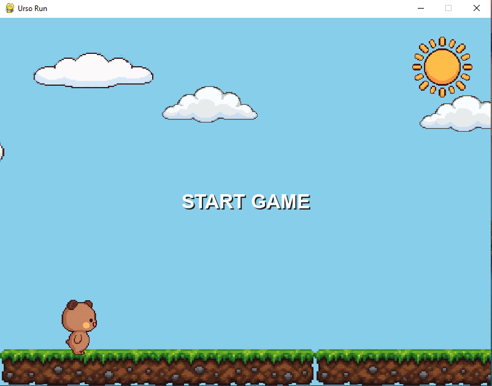

# Urso Run

Jogo de corrida infinita em Python com pygame: o urso corre e você precisa pular os troncos. Quanto mais pontos, mais rápido o jogo fica.



## Jogue agora

[Jogar no navegador (itch.io)](https://felipedsoares.itch.io/urso-run)

Funciona no computador e no celular, sem baixar nada.

## Como jogar

- **Espaço**: começar, pular e reiniciar depois do game over.
- Cada tronco desviado vale 1 ponto.
- A cada 10 pontos a velocidade aumenta 20% (até um limite).

## Baixar e jogar (Windows)

Baixe o `UrsoRun.exe` na página de [Releases](../../releases). O Windows pode exibir um aviso de arquivo desconhecido, algo comum em executáveis feitos com PyInstaller. O código é aberto e está neste repositório.

A versão web é uma adaptação do jogo para o navegador, com controle por toque.

## Rodar pelo código

Requer Python 3 instalado.

```
pip install pygame
python main.py
```

## O que usei e aprendi

- Python e pygame
- Classes e orientação a objetos (urso, tronco, chão e nuvens)
- Estados de jogo, física simples (gravidade e pulo) e detecção de colisão
- Chão infinito e nuvens com efeito de profundidade (parallax)
- Áudio (música de fundo e efeitos sonoros)
- Empacotamento em `.exe` com PyInstaller

## Créditos

- Música e efeitos sonoros: obtidos em [Kenney](https://kenney.nl), jsfxr (gerador de efeitos sonoros) e [Pixabay](https://pixabay.com), usados conforme as licenças de cada site.
- Sol e nuvens: imagens geradas com o Gemini.
- Desenvolvido por Felipe Dias Soares, com apoio de IA para tirar dúvidas e revisar o código.